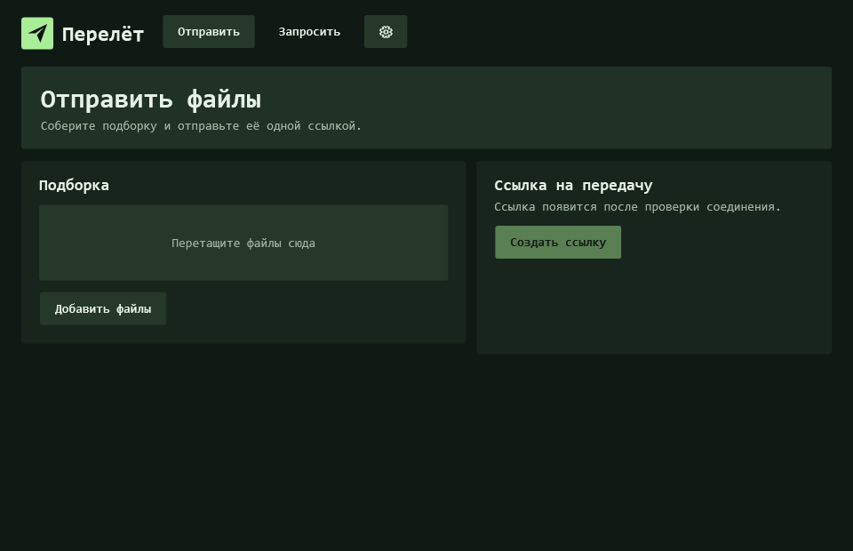

# Blink

**[Подробный гайд по скачиванию и первому запуску](docs/download.md)**

Передача файлов с Windows по ссылке или QR-коду. Отправитель выбирает файлы на компьютере, а получатель открывает страницу в браузере телефона или ПК. Для получения файлов на свой компьютер есть режим «Запросить».

[Скачать для Windows x64](https://github.com/uvi0n/Blink/releases/latest) · [Посмотреть шесть тем](docs/themes.md)

## Начало работы

1. Скачайте ZIP из Releases и распакуйте **всю папку**. Требуются Windows x64 и .NET Framework 4.8.
2. Запустите **Blink.exe** и перетащите файлы в окно. Можно собрать подборку из нескольких папок.
3. Нажмите **Создать ссылку**. Когда приложение проверит адрес через интернет, скопируйте ссылку или покажите QR-код.
4. Оставьте компьютер включённым до конца передачи. Для немедленного закрытия доступа нажмите **Отозвать**.

## Получение в браузере

[Посмотреть мобильную страницу с выбранными файлами](docs/recipient-mobile.png)

Можно скачать один файл, всю подборку или только отмеченные позиции. ZIP64 формируется во время передачи без сжатия и промежуточной копии на диске. Одинаковые имена различаются номерами. Одиночные скачивания поддерживают HTTP Range. ZIP поддерживает возобновление по диапазону байтов в рамках живой сессии.

В обратном режиме выберите папку на компьютере и отправьте ссылку человеку, у которого хотите получить файл. Входящий файл передаётся блоками с проверкой SHA-256 и получает номер при совпадении имён. Отправитель может повторить блок при обрыве в той же вкладке.

## Оформление и настройки

В шестерёнке главного окна есть шесть дизайнов. «Полярная ночь» включена по умолчанию. Выберите дизайн и откройте **RGB-палитру**, чтобы задать цвет визуально или по компонентам R/G/B. Акцент хранится отдельно для каждой темы. Изменения вступают в силу после **Сохранить**.

Там же доступны папка для входящих файлов, срок новых ссылок (1, 6, 12 или 24 часа), подтверждение выхода и сворачивание в системный трей. Настройки Windows-клиента находятся в `%LOCALAPPDATA%\Blink\preferences.xml`.

## Соединение и приватность

Приложение открывает HTTP-сервер на loopback и публикует конкретную сессию через бесплатный временный туннель localhost.run или Cloudflare Quick Tunnel. При наличии Windows OpenSSH первый маршрут использует проверку ключа сервера по файлу lhr_hosts. Установка аккаунта получателю не требуется. Доступ даёт секрет в ссылке или QR-коде. Не публикуйте их в открытых чатах для личных передач.

Провайдер туннеля завершает HTTPS и может видеть содержимое. Для приватной отправки кнопка «Зашифровать файл» создаёт локальную копию age с парольной защитой. Если передать только её, посредник видит зашифрованное содержимое. Пароль передают отдельно. Истечение срока, отзыв, выход из программы или потеря туннеля прекращают доступ. Бесплатные туннели имеют собственные ограничения доступности и скорости. Программа не задаёт лимит размера файла; фактические ограничения определяют диск, файловая система, устройство и время жизни сессии. Прогресс у отправителя показывает число переданных в соединение байтов.

## Сборка

Для сборки нужны Windows x64, .NET Framework 4.8, Rust с инструментами для x64 MSVC и Visual Studio Build Tools с компонентами C++ и Windows SDK. Из корня репозитория выполните

~~~cmd
cd native
cargo test --locked --release
cargo build --locked --release
cd ..
source\build.cmd
~~~

Сборщик создаёт Blink.exe и файл конфигурации в корне. Вызовы идут через штатный компилятор .NET Framework. Для сборки в репозитории есть QRCoder.dll. Для резервного маршрута положите рядом с приложением [cloudflared-windows-amd64.exe 2026.11.2](https://github.com/cloudflare/cloudflared/releases/tag/2026.11.2) под именем cloudflared.exe. В готовой сборке из Releases он уже есть. SHA-256 компонента: `555b46c85582461d189cac30d14ad05480d612613801be9f110b8ce08c5b2113`.

## Исходники

- **source/Desk.xaml, Desk.cs, Themes.cs и Preferences.cs** — WPF-интерфейс, оформление и сохранение настроек.
- **source/Session.cs, LocalHttp.cs и Bundle.cs** — выдача файлов, приём блоков и потоковые архивы.
- **native/src/lib.rs и source/TransferReader.cs** — чтение диапазонов и расчёт CRC-32 при отправке. Ядро входит в Blink.exe. Получателю достаточно браузера, а отправителю достаточно обычной сборки Blink.
- **source/Link.cs и LinkQr.cs** — управление туннелями, проверка адреса и локальная генерация QR-кода.
- **source/page.html и ui.js** — мобильная страница отправителя и получателя.
- **source/test.py, Harness.cs и Verify.cs** — проверки локальной передачи и публичной ссылки.

Сторонние компоненты: [QRCoder 1.6.0](https://github.com/codebude/QRCoder) и [cloudflared](https://github.com/cloudflare/cloudflared). Их лицензии приложены отдельными файлами.

## Дополнительные возможности

Папки со структурой каталогов, второй адрес работающей сессии, меню Проводника «Отправить», подтверждение получателя по коду, отдельные групповые загрузки, миниатюры JPEG/PNG до 32 МиБ и журнал последних 100 операций. Приватная отправка использует [age 1.3.2](https://github.com/FiloSottile/age/releases/tag/v1.3.2). Для сборки из исходников положите age.exe рядом с Blink.exe. Готовый релиз уже содержит этот компонент.

Фирменная иконка Blink — оригинальный гранёный кинжал. Векторный исходник находится в [source/blink-mark.svg](source/blink-mark.svg).

## Автообновление

Запускайте Blink.exe в корневой папке распакованного релиза. При запуске Blink проверяет последний стабильный релиз uvi0n/Blink на GitHub. Новая сборка скачивается в фоне, проверяется по SHA-256 из метаданных GitHub и используется при следующем запуске. Передача файлов в открытом сеансе продолжается. В настройках доступны переключатель «Автоматически скачивать обновления» и кнопка «Проверить обновления». Для установки нужна возможность записи в папку программы.

## Проверки и сборка релиза

После сборки из исходников из каталога source можно собрать автономную проверку следующей командой в PowerShell. Она использует loopback и временные тестовые файлы.

~~~powershell
& "$env:WINDIR\Microsoft.NET\Framework64\v4.0.30319\csc.exe" /nologo /r:..\Blink.exe /out:..\SessionLifecycleTest.exe SessionLifecycleTest.cs
..\SessionLifecycleTest.exe
~~~

Для воспроизводимой структуры переносимого ZIP используйте package.ps1 из корня репозитория. Передайте каталог, содержащий официальные cloudflared.exe и age.exe, в параметре ToolsDirectory и полный путь к выходному ZIP в OutputZip.

## Blink 9

«Новая передача» открывает второе окно. У каждой передачи свои файлы, ссылка, срок действия и кнопка отзыва. Корзина в строке убирает файл из подборки до публикации. Исходный файл остаётся на диске.

Страница получателя и тема по умолчанию используют синюю палитру «Полярная ночь». Кнопка «Нашёл баг» справа вверху открывает меню связи. Команда «Написать» готовит письмо в почтовом приложении. Проверьте текст и отправьте его самостоятельно.

На Windows x64 с Core i7-14700K медиана трёх локальных скачиваний по 128 МиБ для Blink 8 и Blink 9 составила соответственно 464 и 2016 МиБ/с для потокового ZIP, 1854 и 2208 МиБ/с для отдельного файла. Замер через loopback характеризует производительность сервера. Скорость передачи по интернету зависит также от канала и туннеля. Методика и проверка целостности находятся в benchmarks/transfer.py.
